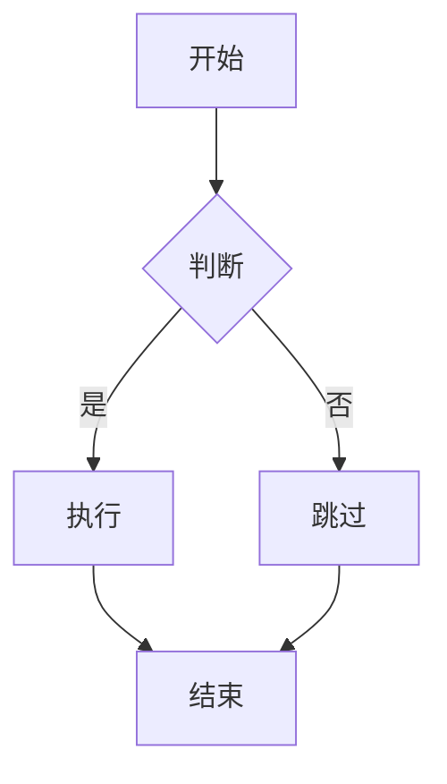
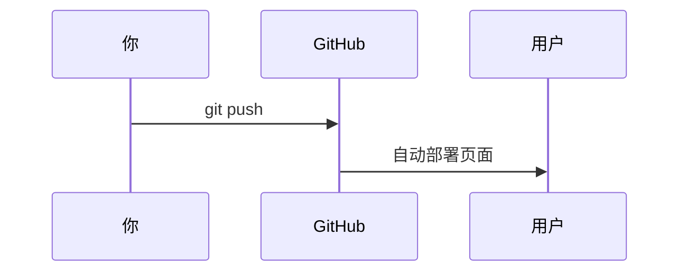

本博客支持的 Markdown 语法全览，持续更新。

## 文本格式

**粗体** `**粗体**`

*斜体* `*斜体*`

~~删除线~~ `~~删除线~~`

`行内代码` `` `行内代码` ``

[链接](https://github.com) `[链接](url)`

## 标题层级

# 一级 `# 一级`

## 二级 `## 二级`

### 三级 `### 三级`

#### 四级 `#### 四级`

## 列表

无序列表：

- 项目一
- 项目二
  - 嵌套项目

有序列表：

1. 第一步
2. 第二步
3. 第三步

任务列表：

- [x] 已完成
- [ ] 未完成

## 引用

> 这是一段引用文字。
>
> 可以多段落。
>
> > 可以嵌套引用。

## 代码块

```python
def hello():
    print("Hello, Jekyll!")
```

```bash
bundle exec jekyll serve --livereload
```

## 表格

| 列 A | 列 B | 列 C |
|------|------|------|
| 数据 1 | 数据 2 | 数据 3 |
| 数据 4 | 数据 5 | 数据 6 |

对齐控制：

| 左对齐 | 居中 | 右对齐 |
|:-------|:----:|-------:|
| left   | mid  | right  |

## 图片

```markdown

```


## 分割线

---

## 脚注

这是一个带脚注的句子[^1]。

[^1]: 这是脚注的内容，会出现在文章底部。

## 流程图 (Mermaid)



时序图：



## HTML 直接嵌入

Markdown 里可以直接写 HTML：

<p style="color: #4c8eda; padding: 10px; border-left: 4px solid #4c8eda;">
  这是一个带样式的提示框。
</p>

<details>
<summary>点击展开折叠内容</summary>

隐藏的文字在这里，适合放长段说明。

</details>
